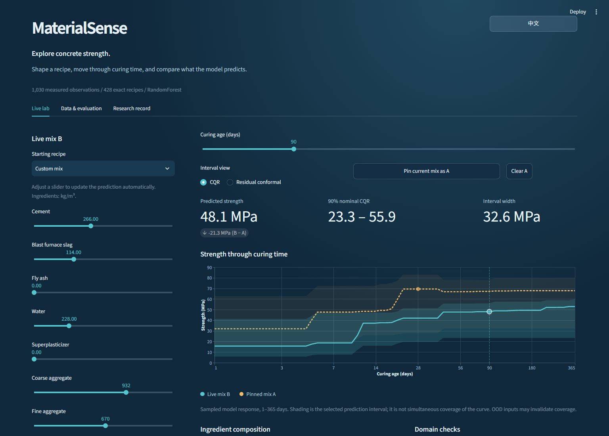

# MaterialSense

MaterialSense is a research and educational Python project that predicts concrete compressive strength from ingredient quantities and curing age. It provides reproducible experiments, uncertainty intervals, novelty warnings and an interactive Streamlit interface. It is **not** a validated tool for engineering design.

## Research design and evidence

The underlying [UCI Concrete Compressive Strength dataset](https://doi.org/10.24432/C5PK67) contains 1,030 observations. Ingredients are measured in kg/m³, curing age in days and strength in MPa. Software is distributed under [MIT](LICENSE); the dataset is separately available under CC BY 4.0. See [data attribution](data/README.md) and [third-party notices](THIRD_PARTY_NOTICES.md).

The ten-seed study groups records by ingredient recipe, preserving distinct evaluation groups. Across the recorded overlapping resplits, grouped MAE is 4.157 ± 0.609 MPa, RMSE 5.641 ± 0.788 MPa and R² 0.878 ± 0.026. These are the mean and sample standard deviation of those resplits, not independent material experiments or confidence intervals. The row-random comparison uses different test records, so the difference is not an isolated causal estimate of leakage. [Metrics](reports/benchmark-10/selected_summary.csv) and [overlap audit](reports/benchmark-10/split_audit.csv) document the evidence.

An ablation found lower group RMSE for the water-to-binder descriptor in all ten recorded comparisons with raw inputs. This comparison does not establish causal effects or a universal ranking. See [ablation results](reports/benchmark-10/ablation.csv) and the [study protocol](docs/study-protocol.md).

The interval and KNN novelty-warning results have important limits: they do not guarantee coverage under distribution shift or establish ground-truth out-of-distribution classification. See [interval results](reports/benchmark-10/interval_summary.csv), [warning results](reports/benchmark-10/risk_summary.csv) and [failure cases](reports/failure-cases.md).

The separate frozen-model [Wu 2019 exploration](reports/external-exploration/wu2019/README.md) contains seven recipes at five ages: all 35 reported means were underpredicted, with MAE 15.327 MPa and RMSE 15.685 MPa. It is an **exploratory cross-source assessment, not formal harmonized external validation**. The published source has a 77.9/76.5 MPa discrepancy and an unconfirmed meaning of ±; source comparability and other limitations are documented there.

## Run locally

Use Python 3.13 and run the following in the project directory. Installing dependencies requires network access. The included UCI data allows the project to run offline after setup; no trained model is included. Training the local demo below writes new outputs only to `artifacts/run`.

```powershell
python -m venv .venv
.\.venv\Scripts\python.exe -m pip install -r requirements.txt
.\.venv\Scripts\python.exe -m pip install -e . --no-deps
.\.venv\Scripts\python.exe -m materialsense.cli run --config configs/experiment.yaml --data data/raw/concrete.csv --output artifacts/run
.\.venv\Scripts\python.exe -m streamlit run app.py
```

On macOS/Linux, use `.venv/bin/python` instead of the Windows Python path. The interface is bilingual. A saved image is shown below. Results depend on the input and fitted model; example predictions are not laboratory measurements.



Run the synthetic tests with `.\.venv\Scripts\python.exe -m pytest -q`. Check the saved ten-seed evidence with `.\.venv\Scripts\python.exe scripts/verify_results.py reports/benchmark-10`. Test and verification results apply to the specific environment and revision recorded; consult the workflow run for the current commit.

## Attribution and limitations

Project maintainer: Derek Qi. The project used AI assistance in implementation, debugging, experimental tooling and documentation. Course presentation and report preparation were separate from the software project. Established methods and third-party data are credited to their sources; no original laboratory data collection or new statistical algorithm is claimed.

The source repository is provided for research and education; this version is not a formal software release. The [project website](https://derekqi.com/projects/materialsense/) provides a separate demonstration and research summary.
